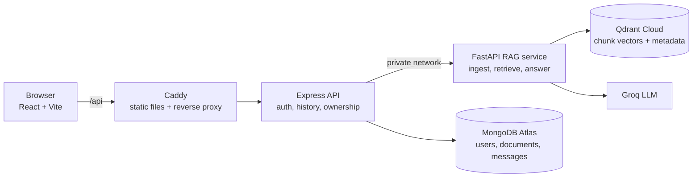

# RAG Study Assistant

A full-stack study assistant that lets you upload PDFs (lecture notes, textbook chapters, papers) and ask questions about them. Answers are generated with **Retrieval-Augmented Generation (RAG)**, grounded strictly in the content of your uploaded document, with source citations (page number and a preview snippet) for every response.

> **Live demo:** `http://54.227.232.58` 

---

## Table of contents

- [Features](#features)
- [Tech stack](#tech-stack)
- [Architecture](#architecture)
- [How it works](#how-it-works)
- [Project structure](#project-structure)
- [Run it with Docker](#run-it-with-docker)
- [Run it without Docker](#run-it-without-docker)
- [Environment variables](#environment-variables)
- [API overview](#api-overview)
- [Deploying to AWS EC2](#deploying-to-aws-ec2)
- [Design decisions](#design-decisions)
- [Problems I hit and what I learned](#problems-i-hit-and-what-i-learned)
- [Limitations and next steps](#limitations-and-next-steps)

---

## Features

- User authentication (register and login with JWT)
- PDF upload and ingestion, with file type and size validation and clear error toasts
- Chat with your document: ask questions and get answers grounded in the source material
- Source citations for every answer (page number and preview snippet)
- Persistent chat history: reopen a document and resume the conversation where you left off
- Per-user isolation: every search is filtered by user and document, so you can only query your own files
- Delete uploaded documents (their vectors and chat history are removed too)
- Fast, low-latency responses through Groq's LLM inference
- Runs as three Docker containers and is deployed on AWS EC2

## Tech stack

| Layer | Technology |
|---|---|
| Frontend | React (Vite), React Router, Axios, react-hot-toast |
| API server | Node.js, Express, MongoDB with Mongoose, JWT authentication, bcryptjs, multer |
| RAG service | FastAPI (Python), LangChain (text splitting and vector store integration), pypdf |
| Embeddings | `all-MiniLM-L6-v2` through fastembed (ONNX, runs locally on CPU, 384 dimensions) |
| Vector database | Qdrant Cloud |
| LLM | Groq (model name set by an environment variable) |
| Database | MongoDB Atlas |
| Containers and proxy | Docker, Docker Compose, Caddy |
| Hosting | AWS EC2 (Ubuntu) |

## Architecture

The Express server handles auth, stores document and chat metadata in MongoDB, and forwards upload and ask requests to the FastAPI RAG service. The RAG service handles chunking, embedding, similarity search in Qdrant, and LLM-based answer generation.



The browser never talks to the RAG service directly. In Docker Compose only the Caddy container publishes ports; the Express and FastAPI containers are reachable only inside the Docker network.

## How it works

### 1. Ingestion (when you upload a PDF)

1. The browser sends the file to the Express API, which validates it and forwards it to the RAG service together with the user's id.
2. The RAG service extracts the text of each page.
3. The text is split into chunks of about **1000 characters with 100 characters of overlap**, so an idea cut at a boundary still appears whole in one chunk.
4. Each chunk is converted into a **384-dimension embedding** with `all-MiniLM-L6-v2`.
5. The vectors are stored in **Qdrant** together with metadata: `doc_id`, `user_id` and the page number. Express saves a document record in MongoDB.

### 2. Question answering (when you ask something)

1. Express confirms the document belongs to the logged-in user.
2. The RAG service embeds the question with the same model and searches Qdrant for the **4 closest chunks, filtered by `doc_id` and `user_id`**.
3. The chunks go into a prompt that tells the model to answer only from the context and to say so when the answer is missing.
4. The LLM (served by Groq) writes the answer. The service returns it with the page numbers and a short preview of each source chunk.
5. Express saves the question and answer in MongoDB (only after success) and returns the result to the browser.

## Project structure

```
.
├── docker-compose.yml
├── package.json            # frontend and API dependencies (repo root)
├── package-lock.json
├── index.html              # Vite entry
├── vite.config.js
├── eslint.config.js
├── public/
├── pyproject.toml          # local Python environment (uv)
├── uv.lock
├── .python-version
└── src/
    ├── client/             # React app, Dockerfile, Caddyfile
    ├── server/             # Express API and Dockerfile
    └── rag-backend/        # FastAPI RAG service and Dockerfile
        ├── main.py         # /upload, /ask, /documents/{doc_id}
        ├── ingest.py       # extract, chunk, embed, store
        ├── retriever.py    # filtered search, grounded prompt, LLM call
        ├── vectorstore.py  # Qdrant connection and filters
        ├── embeddings.py   # local fastembed wrapper
        └── requirements.txt
```

The frontend and the Express API share one `package.json` and lockfile at the repo root, which is why their Docker images are built from the repo root.

## Run it with Docker

Requirements: Docker with Compose, a MongoDB Atlas database, a Qdrant Cloud cluster and a Groq API key.

```bash
git clone https://github.com/Sehajpreet-kaur/AI_Study_assistant.git
cd AI_Study_assistant

# create src/server/.env and src/rag-backend/.env by hand
# (variable names are listed in the "Environment variables" section below)

docker compose up --build
```

Then open <http://localhost>. Stop with `Ctrl+C`, or run `docker compose down`.

> The `.env` files are not committed. Create them yourself and never push secrets to Git.

## Run it without Docker

Run the three parts in separate terminals. You still need the same MongoDB, Qdrant and Groq accounts, and the same `.env` values.

```bash
# 1. RAG service (Python)
cd src/rag-backend
pip install -r requirements.txt      # or install into a uv environment
uvicorn main:app --reload --port 8000

# 2. Express API (Node), from the repo root, with RAG_URL=http://localhost:8000
npm install
node src/server/index.js

# 3. Frontend (Vite), from the repo root
npm run dev
```

For local development, set `RAG_URL=http://localhost:8000` in `src/server/.env` (inside Docker it is set to `http://rag:8000` by `docker-compose.yml`).

## Environment variables

**`src/server/.env`**

| Variable | Purpose |
|---|---|
| `MONGO_URI` | MongoDB Atlas connection string |
| `JWT_SECRET` | Secret used to sign login tokens |

`RAG_URL` (`http://rag:8000`) and `PORT` (`5000`) are set in `docker-compose.yml`.

**`src/rag-backend/.env`**

| Variable | Purpose |
|---|---|
| `GROQ_API_KEY` | Groq API key |
| `GROQ_MODEL` | Model name, for example `openai/gpt-oss-20b` (check Groq's current model list, because older models get retired) |
| `QDRANT_URL` | Qdrant Cloud cluster URL |
| `QDRANT_API_KEY` | Qdrant API key |

**Optional `.env` next to `docker-compose.yml`**

| Variable | Purpose |
|---|---|
| `SITE_ADDRESS` | Your domain, to let Caddy get an HTTPS certificate automatically. Defaults to `:80` (plain HTTP). |

## API overview

The browser reaches the Express API through the proxy under `/api`, and every route needs a valid JWT except registration and login.

**Express (public API)**

| Method | Route | Description |
|---|---|---|
| POST | `/upload` | Upload a PDF (multipart `file`) |
| POST | `/ask` | Ask a question: `{ question, doc_id }` |
| GET | `/messages/:docId` | Chat history for a document |
| GET | `/` | List the user's documents |
| DELETE | `/:id` | Delete a document, its vectors and its chat |

Paths are shown relative to each router file: `/upload`, `/ask` and `/messages/:docId` are defined in `routes/rag.js`, and `/` and `/:id` (list and delete) in `routes/documents.js`. The prefix each router is mounted under is set in `src/server/index.js`. Registration and login routes live in `src/server/routes` too.

**FastAPI (internal only, not exposed publicly)**

| Method | Route | Description |
|---|---|---|
| POST | `/upload` | Extract, chunk, embed and store a PDF |
| POST | `/ask` | Retrieve chunks and generate an answer |
| DELETE | `/documents/{doc_id}` | Remove a document's vectors |

**Errors the app handles**

| Code | Meaning |
|---|---|
| 409 | The document's vectors are missing; the stale record is removed and the user is asked to re-upload |
| 422 | The PDF has no extractable text (for example a scanned image) |

## Deploying to AWS EC2

The app runs on a single Ubuntu EC2 instance with Docker Compose. MongoDB Atlas and Qdrant Cloud stay external, so containers can be rebuilt or replaced without losing data.

1. **Launch** an Ubuntu EC2 instance (a 2 GB RAM size such as `t3.small` is comfortable) with a key pair. Allow SSH from your IP, and HTTP (80) and HTTPS (443) from anywhere.
2. **Attach an Elastic IP** so the address survives stop and start, and add it to the MongoDB Atlas **Network Access** list.
3. **Install Docker and add swap** on the server:
   ```bash
   sudo apt update && sudo apt install -y docker.io docker-compose-v2 git
   sudo usermod -aG docker $USER && newgrp docker
   sudo fallocate -l 2G /swapfile && sudo chmod 600 /swapfile
   sudo mkswap /swapfile && sudo swapon /swapfile
   echo '/swapfile none swap sw 0 0' | sudo tee -a /etc/fstab
   ```
4. **Clone the repo and create the two `.env` files** on the server (they are not in Git).
5. **Build and start:**
   ```bash
   docker compose up -d --build
   ```
6. **Update later:**
   ```bash
   git pull && docker compose up -d --build
   ```

Containers use `restart: unless-stopped`, so they come back by themselves after a reboot.

**HTTPS:** point a domain's A record at the Elastic IP, set `SITE_ADDRESS=yourdomain.com` in a `.env` next to `docker-compose.yml`, and run `docker compose up -d`. Caddy requests and renews a free certificate automatically. Until then the app is served over plain HTTP, so use throwaway credentials.

## Design decisions

| Decision | Reason |
|---|---|
| Three services (React, Express, FastAPI) | Python has the most mature tooling for PDFs and embeddings; Node fit the auth and chat-history layer. The trade-off is one more service to deploy. |
| Chunk size 1000, overlap 100 | A starting baseline: large enough to hold an idea, small enough to stay specific. Not yet tuned. |
| Filter every search by `doc_id` and `user_id` | Isolation at the database level, so one user can never retrieve another user's text. |
| Prompt restricted to the retrieved context | Reduces hallucination and makes answers verifiable against the cited pages. |
| Hosted vector database (Qdrant Cloud) | Vectors survive redeploys; a database file on a container disk does not. |
| Local embeddings with fastembed | No per-request cost or quota, and a small CPU-only install. |
| Model name in an environment variable | Hosted models get retired; changing a setting is faster than a code deploy. |
| Save chat messages only after a successful answer | No orphan questions in the history when the AI call fails. |
| Delete vectors before the Mongo record | If vector deletion fails, the user still sees the document and can retry. |

## Problems I hit and what I learned

| Problem | Cause | Fix and lesson |
|---|---|---|
| Answers said nothing was found after a redeploy | ChromaDB stored vectors on a disk that was wiped on every redeploy, while MongoDB still listed the documents | Moved vectors to Qdrant Cloud and added a 409 path that removes stale records. *Keep state outside containers.* |
| Python service ran out of memory on a 512 MB host | A PyTorch embedding model was too heavy | Moved to a lightweight ONNX runtime (fastembed). *Measure memory before choosing a model.* |
| Container crash-looped with HTTP 402 | Hosted embedding credits ran out, and the vector store checked the embedding size at import time | Switched to local embeddings. *Avoid a hard dependency on a quota at startup.* |
| LLM calls failed with `model_not_found` | The provider retired the hard-coded model | Model name moved into an environment variable. *Watch provider deprecation notices.* |
| Upload produced empty chunks | The PDF was image-based, with no text | Clear error shown as a toast. OCR is a possible extension. |
| Docker build failed on `npm ci` | One `package.json` and lockfile live at the repo root, not in each folder | Built the frontend and API images from the repo root. *Build context matters.* |
| SSH to the server timed out | I was connecting to an Elastic IP that was not attached to the instance | Used the instance's real public IP, then associated the Elastic IP. *Check the address on the instance details page first.* |

## Limitations and next steps

- Scanned PDFs are not supported yet (add OCR as a fallback).
- Each question is answered independently (rewrite follow-ups using chat history).
- Pure vector search can miss exact terms (add hybrid search and a reranker).
- One document per chat (allow searching across several documents).
- Large uploads are processed inside the request (move ingestion to a background job).
- Answers arrive all at once (stream tokens from the LLM).
- No automated tests or retrieval evaluation set yet.
- Served over plain HTTP until a domain is attached.

## Author

Sehajpreet Kaur